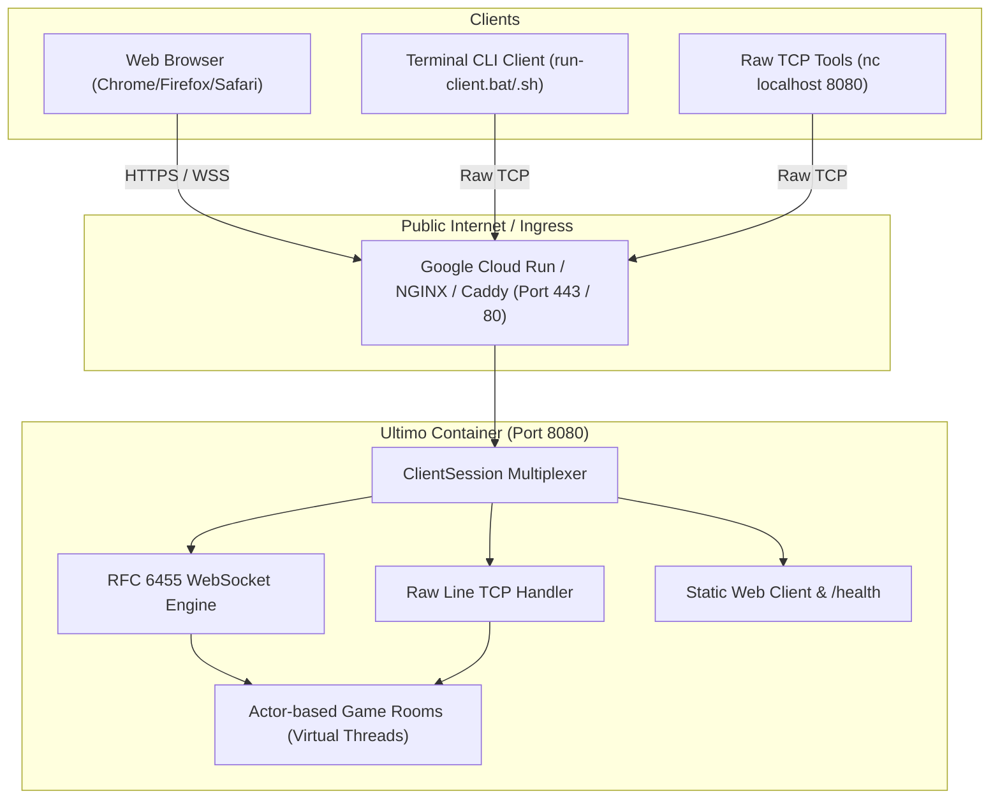

# Ultimo Deployment & Hosting Guide

This guide details how to deploy and host the **Ultimo Server** in production environments, covering **Google Cloud Run (Serverless)**, **Virtual Private Servers (VPS)**, and **Reverse Proxy SSL configurations**.

---

## Architecture Overview

Ultimo features a **Unified Transport Layer**: a single port (default `8080` or dynamically injected via `$PORT`) automatically multiplexes:
- **Raw TCP socket connections** (CLI clients, bots, Netcat).
- **RFC 6455 WebSockets (`ws://` / `wss://`)** for browser clients.
- **HTTP GET requests** serving the embedded single-page HTML5 web client on `GET /` and health checks on `GET /health`.



---

## Option 1: Google Cloud Run (Recommended for FAANG Portfolios)

[Google Cloud Run](https://cloud.google.com/run) is a fully managed serverless platform that runs containers directly on Google's scalable infrastructure.

### Key Advantages
- **Generous Free Tier:** 2 million requests per month for free (effectively $0/month for portfolio projects).
- **Automatic HTTPS & Certificates:** Free SSL/TLS certificate managed by Google (`https://your-service-xyz.a.run.app`).
- **Native WebSocket Support:** Built-in support for long-lived streaming connections and WebSockets.
- **Scale to Zero:** Zero cost when no games are active.

### Deployment Steps

#### 1. Install Google Cloud SDK & Login
```bash
# Authenticate with your Google account
gcloud auth login

# Set your target project ID
gcloud config set project YOUR_PROJECT_ID
```

#### 2. Deploy Using Included Script
Run the automated deployment script from the project root:

- **Linux / macOS:**
  ```bash
  chmod +x cloudrun-deploy.sh
  ./cloudrun-deploy.sh
  ```
- **Windows:**
  ```cmd
  cloudrun-deploy.bat
  ```

#### 3. Manual Deployment Command
```bash
gcloud run deploy ultimo-server \
  --source . \
  --region europe-west1 \
  --allow-unauthenticated \
  --port 8080 \
  --memory 512Mi \
  --cpu 1 \
  --min-instances 0 \
  --max-instances 2 \
  --timeout 3600 \
  --session-affinity
```

> **Why `--session-affinity` and `--timeout 3600`?**  
> Enables sticky routing so all WebSocket frames from a match land on the same container instance, and keeps the socket alive for up to 60 minutes of gameplay.

Once deployed, Google Cloud will output a live URL (e.g. `https://ultimo-server-xyz-ew.a.run.app`). Open it in any browser to play immediately!

---

## Option 2: Linux VPS (Hetzner, DigitalOcean, AWS EC2, OVH)

For dedicated multiplayer hosting where players can connect both via web browser and raw TCP sockets simultaneously on arbitrary ports:

### Requirements
- Any Linux VPS (Ubuntu 22.04+ or Debian 12+) with 1GB RAM (~$3-4/month).
- Docker and Docker Compose installed.

### Steps

#### 1. Clone & Launch Container
```bash
git clone https://github.com/YOUR_USERNAME/Ultimo.git
cd Ultimo
docker compose up -d --build
```

#### 2. Check Service Health
```bash
docker compose ps
docker compose logs -f
```

The server is now live on `http://YOUR_SERVER_IP:8080` (for web browsers) and `YOUR_SERVER_IP:8080` (for raw TCP clients).

---

## Option 3: Production Reverse Proxy with SSL (Caddy / NGINX)

To map a custom domain (e.g., `ultimo.yourdomain.com`) with automated Let's Encrypt SSL certificates:

### A. Using Caddy (Easiest, Auto-SSL)
Create `Caddyfile`:
```caddy
ultimo.yourdomain.com {
    reverse_proxy localhost:8080
}
```
Run Caddy:
```bash
caddy run
```
Caddy automatically provisions SSL certificates and handles WebSocket connection upgrades out of the box.

### B. Using NGINX
```nginx
server {
    listen 80;
    server_name ultimo.yourdomain.com;
    return 301 https://$host$request_uri;
}

server {
    listen 443 ssl http2;
    server_name ultimo.yourdomain.com;

    ssl_certificate /etc/letsencrypt/live/ultimo.yourdomain.com/fullchain.pem;
    ssl_certificate_key /etc/letsencrypt/live/ultimo.yourdomain.com/privkey.pem;

    location / {
        proxy_pass http://127.0.0.1:8080;
        proxy_http_version 1.1;
        proxy_set_header Upgrade $http_upgrade;
        proxy_set_header Connection "upgrade";
        proxy_set_header Host $host;
        proxy_set_header X-Real-IP $remote_addr;
        proxy_read_timeout 3600s;
        proxy_send_timeout 3600s;
    }
}
```

---

## Local Verification

To test the web and WebSocket features locally:

1. Start the server:
   ```cmd
   run-server.bat
   ```
   *(or `./run-server.sh`)*

2. Open your browser and navigate to:
   ```text
   http://localhost:8080
   ```

3. Open a second browser window (or incognito tab) to join as Player 2, or launch `run-client.bat` in a terminal window to play cross-platform between browser and CLI!
